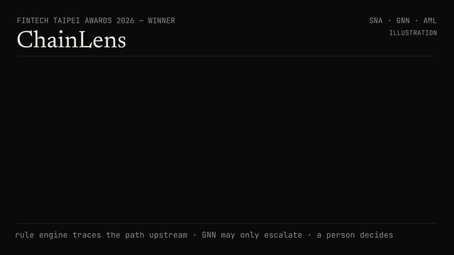
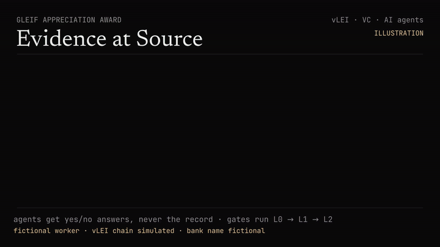
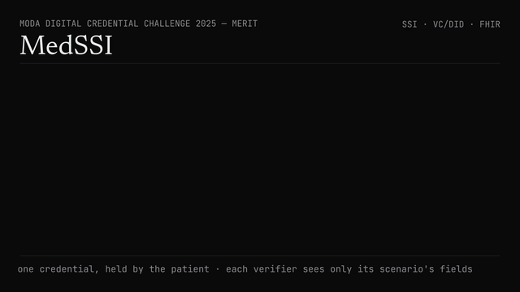
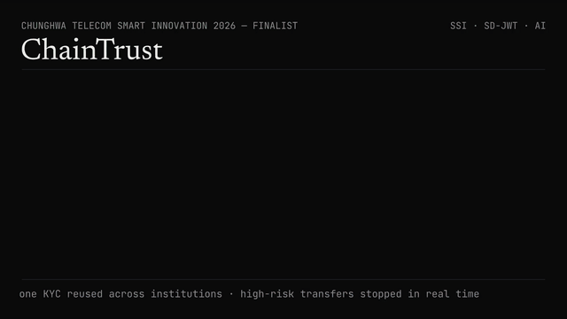
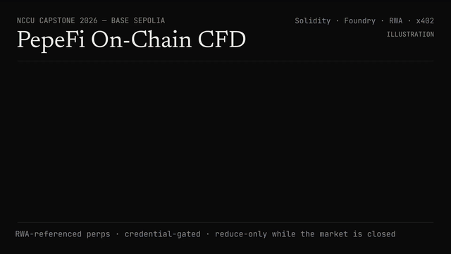
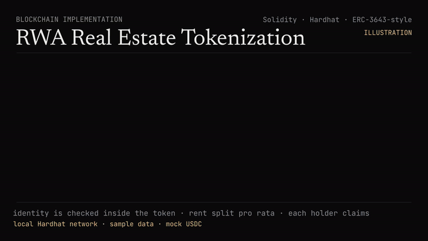
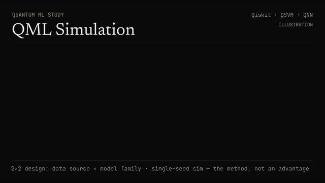

<div align="center">

<a href="https://zuemen.net"></a>

<a href="https://zuemen.net"></a>
<a href="https://www.linkedin.com/in/ting-yi-chu-95838538a/"></a>
<a href="https://orcid.org/0009-0000-5374-9232"></a>


</div>

### `❯ whoami`

```text
$ whoami
Zuemen Chu 朱廷翊 — NCCU MIS ’27 · Blockchain Tech Dev @ Cathay Financial Holdings

$ cat ~/.focus
[1] Self-sovereign identity ..... W3C DID · VC · SD-JWT · Taiwan digital wallet
[2] Agent identity & payments ... agent DIDs · on-chain mandates · x402 (USDC)
[3] Contract security ........... Slither · manual review · Foundry tests
[4] Quantum ML .................. variational QNN · Qiskit · IBM Quantum hardware

$ echo $PRINCIPLE
"Verify the credential, not the person handing it to you."
```

### `❯ tail -f ~/live`

<sub>每 6 小時由 GitHub Actions 重新抓資料、重畫一次（右下角有更新時間）</sub>


### `❯ ./demo --play`

<sub>用 <a href="https://www.manim.community/">Manim</a>（3Blue1Brown 的動畫引擎）製作，原始碼在 <code>manim/</code>；改動後由 GitHub Actions 自動重新算圖</sub>

<a href="https://github.com/zuemen/ChainLens"></a>
<b><a href="https://github.com/zuemen/ChainLens">ChainLens</a></b> · 🏆 FinTech Taipei Awards 2026 — Winner · <a href="https://github.com/zuemen/zuemen/blob/main/assets/manim/chainlens.mp4">▶ 1080p</a><br/>
<sub>規則引擎沿資金路徑往上游回溯，GraphSAGE 評估目的地周邊結構；模型只能把放行升為加強審查、不能自行扣留或降級，每個警示附證據鏈與 STR 草稿，由人決定。（合成情境，模型以合成資料訓練與測試）</sub>

<br/>

<a href="https://github.com/zuemen/evidence-at-source"></a>
<b><a href="https://github.com/zuemen/evidence-at-source">Evidence at Source</a></b> · 🏆 GLEIF Appreciation Award · <a href="https://github.com/zuemen/zuemen/blob/main/assets/manim/evidence-at-source.mp4">▶ 1080p</a><br/>
<sub>移工持有雙方簽章的事實憑證；AI 代理依序通過 L0 授權 → L1 憑證 → L2 提問三道閘門，只拿到是非題答案與 k-匿名匯總，拿不到原始資料，仲介費金額從不揭露。（虛構人物，vLEI 鏈為模擬）</sub>

<br/>

<a href="https://github.com/zuemen/pepelab_v2"></a>
<b><a href="https://github.com/zuemen/pepelab_v2">MedSSI</a></b> · 🏆 Digital Credential Challenge 2025 — Merit Award · <a href="https://github.com/zuemen/zuemen/blob/main/assets/manim/medssi.mp4">▶ 1080p</a><br/>
<sub>醫院發一次健康憑證，病人存在政府數位皮夾；藥局與授權驗證方各自只看到情境允許的欄位，越界請求直接拒絕。（虛構病人；發卡與驗章在 2025 數位部錢包沙盒）</sub>

<br/>

<a href="https://github.com/zuemen/ChainTrust"></a>
<b><a href="https://github.com/zuemen/ChainTrust">ChainTrust</a></b> · 🔷 Chunghwa Telecom Smart Innovation 2026 — Finalist · <a href="https://github.com/zuemen/zuemen/blob/main/assets/manim/chaintrust.mp4">▶ 1080p</a><br/>
<sub>一次 KYC、跨機構重用（SD-JWT 最小揭露：只揭露 kycLevel，姓名、生日不外流）；AI 防詐以 0–100 風險分數分三段，即時攔截高風險轉帳。（概念驗證；中華電信整合點為 mock，防詐模型以合成資料訓練）</sub>

<br/>

<a href="https://github.com/zuemen/pepelab_onchain_cfd"></a>
<b><a href="https://github.com/zuemen/pepelab_onchain_cfd">PepeFi On-Chain CFD</a></b> · 🟡 NCCU Capstone 2026 — Base Sepolia Testnet · <a href="https://github.com/zuemen/zuemen/blob/main/assets/manim/pepefi.mp4">▶ 1080p</a><br/>
<sub>參考美股、黃金、加密的永續 CFD；RWA 部位需鏈上驗證的合格投資人憑證（團隊自簽），休市只能 reduce-only，agent session 有鏈上上限，訊號以 x402 付費。（Base Sepolia 測試網、合成曝險）</sub>

<br/>

<a href="https://zuemen.net/projects#rwa-tokenization"></a>
<b><a href="https://zuemen.net/projects#rwa-tokenization">RWA Real Estate Tokenization</a></b> · Blockchain Implementation · <a href="https://zuemen.net/projects#rwa-tokenization">▶ 1080p</a><br/>
<sub>身分檢查寫在代幣合約裡：非白名單地址的轉讓由合約自己拒絕；租金依持有比例分配，持有人自行領取。（本地 Hardhat 網路、範例資料）</sub>

<br/>

<a href="https://zuemen.net/projects#qml-simulation"></a>
<b><a href="https://zuemen.net/projects#qml-simulation">QML Simulation</a></b> · Quantum ML Study · <a href="https://zuemen.net/projects#qml-simulation">▶ 1080p</a><br/>
<sub>資料來源 × 模型家族的 2×2 設計，區分資料優勢與模型優勢；ZZFeatureMap 量子核 QSVM、變分 QNN 對照邏輯迴歸。（單一 seed、notebook 未存結果：展示方法，不代表優勢）</sub>

<br/>

<a href="https://zuemen.net/projects"><b>全部專案與案例研究 →</b></a> <sub>zuemen.net/projects</sub>

### `❯ ls ~/builds`

| #    | REPO | THESIS | STACK | STATUS |
| ---- | ---- | ------ | ----- | ------ |
| `01` | **[ChainLens](https://github.com/zuemen/ChainLens)** | 虛擬資產提領篩查：規則引擎 + GraphSAGE，每個旗標附證據鏈 | `Python` `GNN` `Next.js` | 🏆 `AWARD` |
| `02` | **[evidence-at-source](https://github.com/zuemen/evidence-at-source)** | 移工持有的雙簽憑證，AI 代理只拿到 boolean，拿不到資料 | `TypeScript` `vLEI` | 🏆 `AWARD` |
| `03` | **[pepelab_v2](https://github.com/zuemen/pepelab_v2)** | MedSSI：FHIR 路徑選擇性揭露，串接數位發展部錢包沙盒 | `Python` `FastAPI` `VC/DID` | 🏆 `AWARD` |
| `04` | **[ChainTrust](https://github.com/zuemen/ChainTrust)** | SSI 金融身分錢包：SD-JWT 跨機構重用 KYC + AI 即時防詐 | `SSI` `SD-JWT` `AI` | 🔷 `FINALIST` |
| `05` | **[pepelab_onchain_cfd](https://github.com/zuemen/pepelab_onchain_cfd)** | PepeFi：RWA 參考的永續 CFD，憑證門檻 + 代理 session | `Solidity` `Foundry` | 🟡 `CAPSTONE` |
| `06` | **RWA Tokenization** | 身分檢查內建於代幣合約的不動產分割持有與租金分配 | `Solidity` `Hardhat` `React` | 🟡 `PROTOTYPE` |
| `07` | **QML Simulation** | 2×2 設計比較量子／古典資料與模型（QSVM、QNN） | `Qiskit` `Python` | 🟡 `RESEARCH` |

🏆 `AWARD` 得獎 · 🔷 `FINALIST` 決賽 · 🟡 開發／研究中 · 全部僅部署於測試網

### `❯ cat stack.toml`

| DESK | INSTRUMENTS |
| ---- | ----------- |
| **`on-chain`** |     |
| **`identity`** |    |
| **`ml / quantum`** |    |
| **`app`** |    |

### `❯ git log --stat`

<div align="center">

</div>

### `❯ echo $CONTACT`

```text
open to  ›  research collaboration · digital identity · agent payments · QML
reach me ›  zuemen.net · 112306007@g.nccu.edu.tw
```
